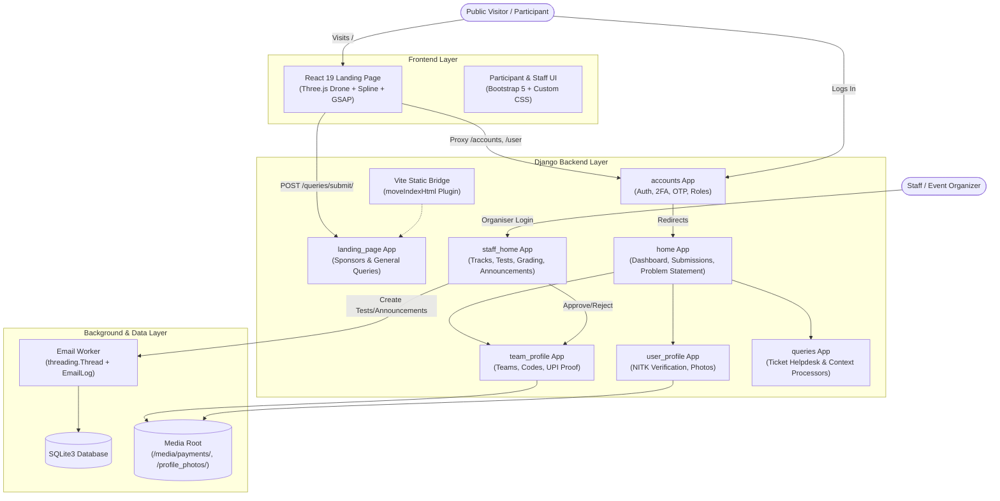
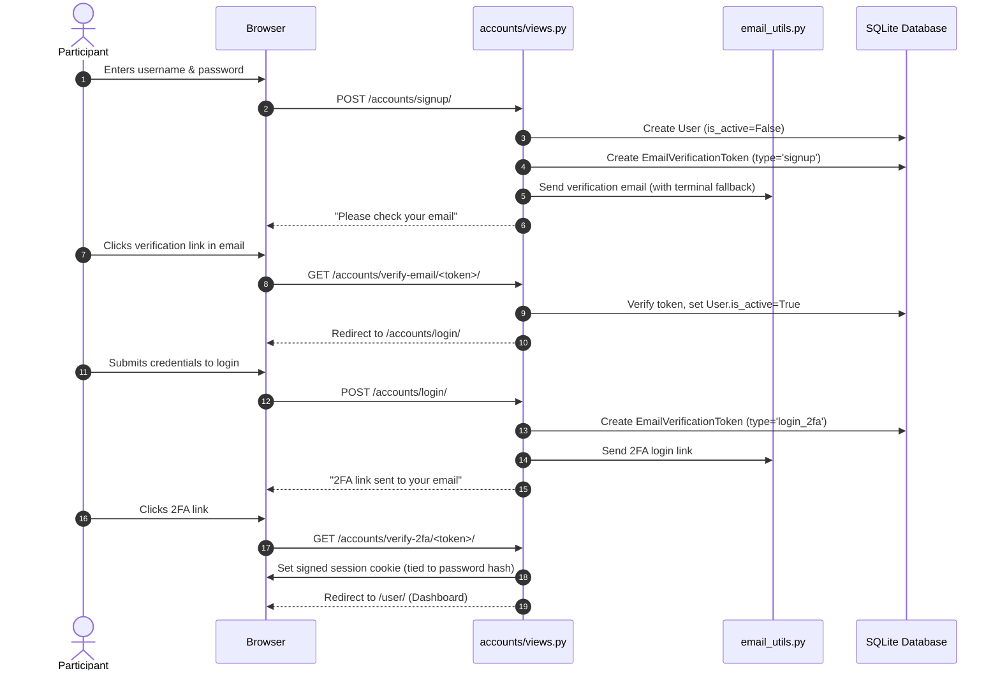
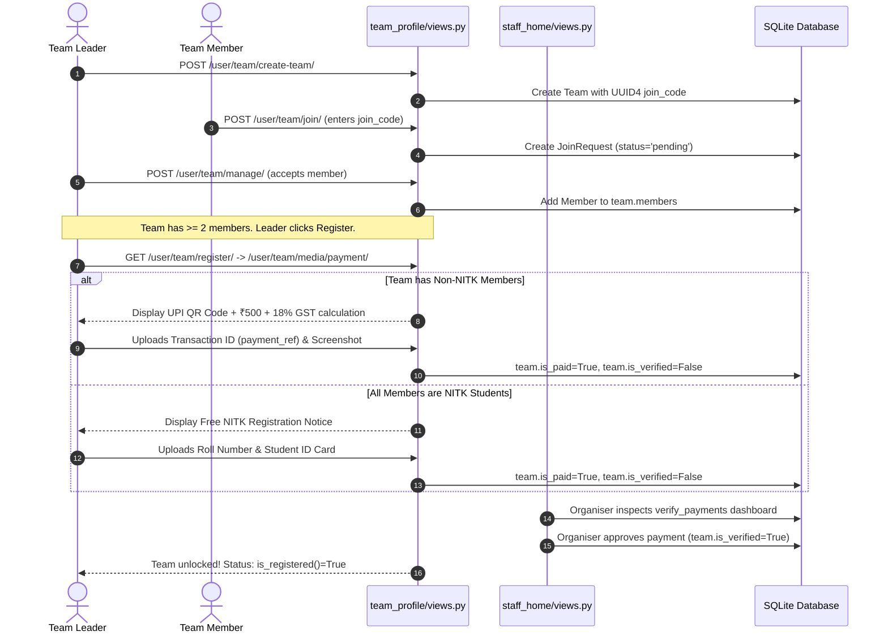
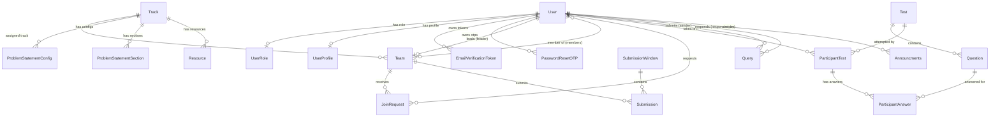

# Sim2Real Repository: Complete Architectural & Technical Deep Dive

This document provides a comprehensive, end-to-end technical analysis of the **Sim2Real** repository. It covers the full technology stack, system architecture, data models, business workflows, application flows, UI/UX mechanics, security models, and deployment configurations.

---

## 1. Executive Summary & Repository Purpose

**Sim2Real** is a full-stack robotics competition and hackathon platform developed for **Robotech NITK** (National Institute of Technology Karnataka, Surathkal) in collaboration with **Engineer NITK**.

The platform serves three distinct operational facets:
1. **Public Marketing & Immersive Landing Experience**: A modern React 19 single-page application featuring real-time 3D drone rendering (Three.js / React Three Fiber), bloom post-processing, Spline 3D robot scene, GSAP-driven scroll timelines, countdown timer, event rulebook/brochure distribution, FAQ, sponsor showcase, and anti-spam contact form.
2. **Participant Portal**: An authenticated dashboard where participants complete demographic profiles, form 2–3 member teams, issue unique UUID join codes, choose competition tracks, upload UPI payment proofs (with fee waivers for NITK students), access track-specific problem statements and resources, and submit deliverables into organizer-configured submission windows.
3. **Organizer & Staff Command Center**: A management portal providing analytics dashboards, payment verification workflows, multi-track problem statement builders, brochure managers, project submission grading, comprehensive online MCQ/coding test creators, helpdesk query resolution, and multithreaded batch email broadcasting with retry logging.

---

## 2. Technology Stack Breakdown

```
┌────────────────────────────────────────────────────────────────────────┐
│                          SIM2REAL TECH STACK                           │
├──────────────────────────────────┬─────────────────────────────────────┤
│ Frontend (Landing & Visuals)     │ Backend & Infrastructure            │
├──────────────────────────────────┼─────────────────────────────────────┤
│ • React 19.2.4 (React DOM 19)    │ • Python 3.10+ / Django 5.1.7       │
│ • Vite 8.0.1 + @vitejs/plugin    │ • Django REST Framework 3.15.2      │
│ • Tailwind CSS v4.2.2            │ • SimpleJWT 5.5.0                   │
│ • Three.js 0.183.2               │ • SQLite (db.sqlite3) / Gunicorn    │
│ • React Three Fiber 9.5.0        │ • Pillow 10.4.0 (Image Processing)  │
│ • React Three Drei 10.7.7        │ • Crispy Forms 2.4 (Bootstrap 4/5)  │
│ • @react-three/postprocessing    │ • Python-Dotenv / Python-Dateutil   │
│ • @splinetool/react-spline 4.1.0 │ • Django Core Mail (SMTP / Console) │
│ • GSAP 3.14.2 (ScrollTrigger)    │ • Google reCAPTCHA Verification     │
│ • Lucide React 1.7.0             │ • Asynchronous Threaded Workers     │
│ • Space Grotesk & Syne Fonts     │ • Custom 2FA & Session Security     │
└──────────────────────────────────┴─────────────────────────────────────┘
```

### Detailed Component Inventory:

| Layer | Technology | Version | Purpose / Role |
| :--- | :--- | :--- | :--- |
| **Frontend Framework** | React | `^19.2.4` | Component-based rendering for public-facing interface |
| **Bundler & Tooling** | Vite | `^8.0.1` | ESM development server and production bundler |
| **Styling & Design** | Tailwind CSS | `^4.2.2` | Utility-first CSS styling using Vite engine |
| **3D Engine** | Three.js | `^0.183.2` | Core WebGL engine for 3D model rendering and lighting |
| **React 3D Bridge** | React Three Fiber (R3F) | `^9.5.0` | Declarative 3D scene graph within React components |
| **3D Helpers** | React Three Drei | `^10.7.7` | Camera controls, environment presets, GLTF loader |
| **Post-Processing** | `@react-three/postprocessing`| `^3.0.4` | Selective Bloom luminance glow for drone thrusters |
| **Interactive 3D** | `@splinetool/react-spline` | `^4.1.0` | Embedded Spline robot scene |
| **Animations** | GSAP & ScrollTrigger | `^3.14.2` | Scroll-linked camera translations and text reveals |
| **Backend Framework** | Django | `5.1.7` | High-level Python web framework |
| **API Layer** | Django REST Framework | `3.15.2` | JSON endpoints for AJAX form and query interactions |
| **Token Auth** | `djangorestframework-simplejwt` | `5.5.0` | JWT support for modular API access |
| **Forms Templating** | `django-crispy-forms` | `2.4` | Bootstrap form rendering across templates |
| **Email Subsystem** | Django SMTP & Threading | Native | Asynchronous batch emailing with retry queues |
| **Image Processing** | Pillow | `10.4.0` | Upload processing for profile photos, QR, proofs |

---

## 3. High-Level System Architecture

The project employs a **hybrid architecture**:
- The public root (`/`) serves a compiled Vite bundle within a Django template wrapper (`landing_page/templates/landing_page/index.html`).
- State variables (`user.is_authenticated`, `team.is_registered`, `profile_completed`) are injected server-side into the `window` object by Django prior to hydration.
- The internal participant and organizer portals (`/accounts/`, `/user/`, `/staff/`, `/user/team/`, `/user/query/`) utilize Django templates styled with Bootstrap 5, custom CSS, and vanilla JavaScript AJAX interactions.



---

## 4. Comprehensive App-by-App Analysis

### 4.1. `simreal` (Project Core & Routing)
- **Settings (`simreal/settings.py`)**:
  - `INSTALLED_APPS`: `landing_page`, `team_profile`, `accounts`, `home`, `user_profile`, `queries`, `staff_home`, `django.contrib.sitemaps`.
  - `TIME_ZONE = 'Asia/Kolkata'`
  - `CSRF_TRUSTED_ORIGINS`: Configured for `http://localhost:5173` and `http://127.0.0.1:5173` for Vite dev proxy.
  - `X_FRAME_OPTIONS = 'SAMEORIGIN'`: Allows embedding views within dashboard iframes.
  - `SESSION_EXPIRE_AT_BROWSER_CLOSE = True`.
  - Context Processors: Injects `queries.context_processors.sidebar_queries` and `home.context_processors.sidebar_context` into every template across the site.
- **Middleware (`simreal/middleware/maintenance_middleware.py`)**:
  - `MaintenanceModeMiddleware`: Checks `settings.MAINTENANCE_MODE`. When enabled, blocks all non-staff users with HTTP 503 while allowing staff members to bypass.
- **Root URLs (`simreal/urls.py`)**:
  - `/admin/` &rarr; Django Admin
  - `/accounts/` &rarr; Authentication routes
  - `/user/` &rarr; Participant dashboard (`home.urls`)
  - `/` &rarr; Landing page routes
  - `/user/team/` &rarr; Team creation, joining, payment
  - `/user/query/` &rarr; Query hub
  - `/staff/` &rarr; Organizer dashboard and workflows
  - `/robots.txt` & `/sitemap.xml` &rarr; SEO crawlers

---

### 4.2. `accounts` (Authentication, 2FA, OTP & Roles)
- **Models (`accounts/models.py`)**:
  1. `UserRole`: `OneToOneField` with `User`. Stores `is_organiser` (default `False`) and `is_staff_member`. Auto-created on user registration via `post_save` signal.
  2. `PasswordResetOTP`: Stores 6-digit numeric OTPs linked to a user with timestamp; expires after 10 minutes.
  3. `EmailVerificationToken`: Secure token mechanism with `TOKEN_TYPE_CHOICES` (`signup` and `login_2fa`). Tokens use cryptographically secure `secrets.token_urlsafe(32)` hashed with SHA-256 (`token_hash`).
- **Security & Session 2FA Architecture (`accounts/decorators.py`)**:
  - Implements **Password Fingerprint Invalidation**: Computes a SHA-256 fingerprint of `user.password` (`_get_user_auth_fingerprint`). If a user resets or changes their password, all existing 2FA sessions and cookies are automatically invalidated.
  - Verified 2FA state is stored in both Django session (`is_2fa_verified`) and an HTTP-only, SameSite signed cookie (`twofa_verified_user_<id>`) with a 12-hour max age (`SESSION_2FA_MAX_AGE = 864000`).
- **Views (`accounts/views.py`)**:
  - `login_view`: Supports login by username or email. If unverified (`is_active=False`), dispatches a signup activation link. If active, triggers email-based 2FA login verification with a 15-minute token. Prints clickable activation URLs directly to terminal logs for local development convenience.
  - `signup_view`: Enforces password validation, rejects mismatching passwords. Prevents user enumeration by showing a generic confirmation message even if an account already exists.
  - `verify_email_view`: Activates unverified accounts upon token validation.
  - `verify_2fa_view`: Completes login when the participant clicks their 2FA email link.
  - `request_otp_view` & `verify_otp_view`: Standalone 6-digit OTP password reset workflow.
  - `logout_view`: Flushes the user session.
- **Commands (`accounts/management/commands/delete_unverified_users.py`)**:
  - Management command to delete stale inactive user records that failed to verify.

---

### 4.3. `user_profile` (Participant Profiles & NITK Validation)
- **Models (`user_profile/models.py`)**:
  - `UserProfile`: Linked One-to-One with `User`.
    - Fields: `first_name`, `last_name`, `contact` (10-digit regex verified), `branch`, `college`, `year`, `dob` (date of birth), `photo` (`profile_photos/`), `event_year` (default 2026), `user_state` (`Active` or `Archived`).
    - `is_nitk_user()`: Returns `True` if the user's email ends with `@nitk.edu.in` or `.nitk.edu.in`, or if their college is explicitly `"National Institute of Technology Karnataka"`.
    - `is_complete()`: Enforces that all 7 mandatory profile fields are non-empty before permitting access to event features.
- **Validation Rules (`user_profile/forms.py`)**:
  - Contact must match `^\d{10}$`.
  - Age gating: Participant age must be between **18 and 30 years** computed dynamically from `date.today()`.
  - Photo format: Strict `.jpg` and `.jpeg` enforcement.
  - NITK lock: If user is verified NITK via email, college is permanently set to `"National Institute of Technology Karnataka"` and read-only.

---

### 4.4. `team_profile` (Team Formation, Join Requests & UPI Payment)
- **Models (`team_profile/models.py`)**:
  - `Team`:
    - `name`: Max 100 chars.
    - `join_code`: Unique `UUID4` generated per team.
    - `leader`: `OneToOneField` with `User` (a user can lead at most one team).
    - `members`: `ManyToManyField` with `User` (related name `team`). Max team size is 3 (`is_full()` returns `True` when &ge; 3).
    - `is_paid`: Boolean indicator of payment proof submission.
    - `is_verified`: Boolean indicator of organizer approval (`is_registered() = is_paid and is_verified`).
    - `payment_screenshot`: Screenshot upload saved to `payments/` (renamed automatically to `<payment_ref>.<ext>`).
    - `payment_ref`: UTR / UPI transaction ID / Roll number.
    - `rejection_reason`: Feedback text populated by organizers if payment proof is rejected.
    - `track`: `ForeignKey` to `staff_home.Track`.
    - `is_outsider()`: Evaluates all team members. If any member belongs to a non-NITK institution, the entire team is categorized as an "outsider" team subject to payment.
  - `JoinRequest`: Represents requests by users to join an existing team via join code. Status: `pending`, `accepted`, `declined`. `unique_together = ('user', 'team')`.
- **Views & Business Logic (`team_profile/views.py`)**:
  - `team_profile_views`: Entry router. Redirects team leaders to `create_team_with_code` and joined members to `join_team_with_code`.
  - `create_team`: Team creation assigning the creator as leader and initial member.
  - `join_team`: Allows participants to enter a UUID join code to file a `JoinRequest`.
  - `manage_requests`: Team leader controls to accept or decline join requests (atomic transaction).
  - `register_for_event`: Requires a minimum of 2 members before routing the leader to the payment page.
  - `payment_view`:
    - Reads dynamic fee amount and QR code from `PaymentConfig`.
    - Outside teams pay standard fee + 18% GST and upload transaction ID + receipt screenshot.
    - NITK teams are exempt from registration fees, uploading student roll numbers and ID card proof instead.

---

### 4.5. `home` (Participant Dashboard & Submissions)
- **Views (`home/views.py`)**:
  - `home_view`: Core dashboard displaying active team details, member counts, assigned track, active submission windows, submitted queries, and targeted announcements (`GENERAL` + `REGISTERED` or `NOT_REGISTERED`).
  - `problem_statement_view`:
    - Access gated by `team.is_registered()`.
    - Renders assigned `Track` details, downloadable problem statement document, qualifying status, and ordered modular sections (`ProblemStatementSection`).
    - Allows teams to switch their track if multiple active tracks exist.
  - `user_submission_windows`: Lists active windows where `is_visible=True` and `end_date >= now()`.
  - `submit_to_window`: Form allowing team leaders to upload/update their project submission URL for an evaluation window.
  - `download_brochure`: Fetches the latest uploaded event brochure PDF.
  - `resources_view`: Displays developer resources, documentation links, and starter files.
- **Context Processors (`home/context_processors.py`)**:
  - `sidebar_context`: Injects `registered`, `user_in_team`, and `user_team` variables into every template across the portal for consistent navigation bar state.

---

### 4.6. `staff_home` (Organizer Operations & Command Hub)
- **Models (`staff_home/models.py`)**:
  1. `Announcments`: Broadcast message, validity dates, manual visibility overrides, category (`GENERAL`, `REGISTERED`, `NOT_REGISTERED`), and `schedule_for_later`.
  2. `Track`: Multi-track competition structure (`name`, `description`, `enabled`, `file`, `qualifying_status`, `order`).
  3. `ProblemStatementConfig` & `ProblemStatementSection`: Ordered content sections (`title`, `content`, `order`) per track.
  4. `Resource`: Downloadable files or documentation URLs categorized by track.
  5. `Brochure`: Official competition PDF brochure.
  6. `SubmissionWindow`: Evaluation time windows (`start_date`, `end_date`, `is_visible`, `created_by`).
  7. `Submission`: Links team project submissions to a window with organizer score grading.
  8. `Test`: Online MCQ/Coding test definition (`code`, `start_datetime`, `end_datetime`, `duration` in minutes, `is_visible`, `event_year`).
  9. `Question`: Test question bank (`question_type`: single, multiple, code; `marks`, `negative_marks`, `options` JSON, `correct_answer` JSON, `compiler_enabled`).
  10. `ParticipantTest`: Records student attempts, start/end timestamps, and aggregate score.
  11. `ParticipantAnswer`: Stores submitted answer JSON and individual question marks awarded.
  12. `EmailLog`: Audit and retry queue for emails (`recipient`, `subject`, `attempts`, `status`: pending/failed, `task_type`: announcement/query).
  13. `PaymentConfig`: Dynamically configurable registration fee (`amount`), payee name, and UPI QR code image.
- **Asynchronous Email Pipeline (`staff_home/email_utils.py`)**:
  - Uses daemon `threading.Thread` instances to prevent blocking web requests.
  - Announcements are dispatched in batches of 50 (`BATCH_SIZE = 50`).
  - Retries failed deliveries up to 3 times (`MAX_RETRIES = 3`) with 1-second backoff.
  - Successfully sent messages delete their `EmailLog` record; persistent failures are recorded with status `failed`.
- **Views (`staff_home/views.py`)**:
  - `staff_dashboard`: Real-time operational metrics (total users, registered teams, pending payments, graded submissions, unresolved queries, active tests).
  - `verify_payments`: Filter by pending/approved/rejected, review transaction IDs, view uploaded screenshots in high resolution, approve/reject with feedback notes, and update global `PaymentConfig`.
  - `all_users_view`: Searchable, filterable directory with pagination and CSV export (`users.csv`).
  - `checkregistration`: Team registration audit table with outsider filters, payment statuses, and CSV export (`registrations.csv`).
  - `manage_problem_statement`, `add_track`, `edit_track`, `add_section`, `edit_section`: Complete CMS for multi-track rulebooks.
  - `manage_submissions`, `create_window`, `grade_submission`: Window scheduling and live submission scoring.
  - `list_tests`, `create_test`, `manage_questions`, `add_question`, `view_submissions`: MCQ/Coding assessment management.

---

### 4.7. `queries` (Helpdesk & Ticketing Subsystem)
- **Models (`queries/models.py`)**:
  - `Query`:
    - `ticket`: Unique `UUID4` identifier.
    - `sender`: ForeignKey to `User` (null for anonymous/sponsor queries).
    - `name`, `email`, `contact`, `organisation`.
    - `message`: Inbound inquiry text.
    - `response`: Organizer reply.
    - `resolved`: Boolean flag.
    - `responded_by`: Organizer who resolved the query.
- **Workflow (`queries/views.py`)**:
  - When a query is filed, `send_query_received_email` notifies event organizers.
  - When an organizer submits a response via `resolve_query`, `send_query_reply_email` sends the resolution to the user.
  - `sidebar_queries` context processor supplies the current user's open/resolved tickets to every dashboard view.

---

### 4.8. `landing_page` (Public Web Experience & 3D Integration)
- **Models (`landing_page/models.py`)**:
  - `Sponsor`: Name, tier (`Gold`, `Platinum`, `Silver`, `Bronze`).
  - `GeneralQuery`: Public landing page inquiries with name, contact email, institution, and message.
  - `Query`: Dedicated sponsor contact inquiries.
- **Views (`landing_page/views.py`)**:
  - `main_landing_page_view`: Passes authentication and registration states to `landing_page/index.html`.
  - `general_query_submit_view`: Validates submissions against Google reCAPTCHA via `https://www.google.com/recaptcha/api/siteverify`.
  - `robots_txt`: Serves dynamic robots indexing instructions pointing to `sitemap.xml`.

---

## 5. React 19 Frontend Architecture & 3D Visual Engine

The frontend is located at `src/` (with a mirrored setup at `landing_page/frontend/src/`) and compiles directly into Django's static directory.

### 5.1. Vite Build & Template Injection Pipeline
Configured in `vite.config.js`:
```javascript
// Custom Vite Rollup plugin
function moveIndexHtml() {
  return {
    name: 'move-index-html',
    closeBundle() {
      const src = path.resolve(__dirname, 'landing_page/static/landing_page/react/index.html');
      const dest = path.resolve(__dirname, 'landing_page/templates/landing_page/index.html');
      if (fs.existsSync(src)) {
        fs.copyFileSync(src, dest);
        fs.unlinkSync(src);
      }
    }
  }
}
```
- **Chunk Splitting Optimization**:
  - `3d-engine`: Three.js, `@react-three/fiber`, `@react-three/drei`, Spline
  - `react-core`: React, React DOM
  - `animations`: GSAP, ScrollTrigger
  - `vendor`: All other utility libraries

### 5.2. Component Graph & Visual Mechanics

```
App.jsx
 ├── CanvasErrorBoundary (WebGL context error catcher)
 │    └── DroneScene (Lazy-loaded Canvas)
 │         ├── PerspectiveCamera (fov: 35)
 │         ├── Lights (Ambient, Directional, Spot, City Environment)
 │         ├── DroneModel (droneage2.glb, 4 rotating propellers, neon materials)
 │         ├── DroneController (Mathematical idle levitation & roll physics)
 │         └── EffectComposer (High-Dynamic-Range Bloom Glow Filter)
 ├── Navigation (Fixed frosted glass, dynamic register/dashboard pill)
 ├── Hero
 │    ├── GSAPReveal (Split-text typography sequence)
 │    ├── FadeIn (Subtext & CTA buttons)
 │    ├── Countdown (Target timestamp date math)
 │    └── Spline 3D Robot (Lazy-loaded iframe container)
 ├── Timeline (Event milestone cards)
 ├── PrizesBrochure (Card reveals, collaborators, brochure PDF download)
 ├── Testimonials (Quote carousel with GSAP staggered word reveals)
 ├── FAQ (Pinned accordion with ScrollTrigger pinning)
 ├── ContactMap (AJAX query form + Google Maps iframe)
 └── Footer (NITK details, legal PDFs, location links)
```

### 5.3. 3D Drone & GSAP Scroll Synchronization
- **Model Loader (`src/components/DroneModel.jsx`)**:
  - Loads GLTF asset `droneage2.glb`.
  - Dynamically traverses the mesh scene graph: converts propeller and neon meshes into `MeshStandardMaterial` with emissive intensity set to 50 (`#0066FF`), disabling tone mapping for maximum Bloom reactivity.
  - Rotates four propeller nodes (`Rotation`, `Rotation001`, `Rotation002`, `Rotation003`) at 35 rad/s in `useFrame`.
- **Camera & Scroll Choreography (`src/components/DroneScene.jsx`)**:
  - Uses an internal proxy object (`x`, `y`, `z`, `rotX`, `rotY`, `rotZ`, `scale`).
  - GSAP timeline scrubs with scroll:
    - **Phase 1 (Timeline section)**: Drone locks to the left margin at `scale: 0.01`.
    - **Phase 2 (Prizes section)**: Drone glides to the center viewport at `scale: 0.02`.
    - **Phase 3 (Brochure section)**: Drone accelerates upward into the sky (`y: 80`) before exiting.
  - `DroneController` adds continuous idle floating physics:
    $$y_{\text{idle}} = \sin(t \times 1.6) \times 0.06$$
    $$\text{roll}_{\text{idle}} = \sin(t \times 0.9) \times 0.025$$

---

## 6. End-to-End Operational Flows

### Flow 1: Participant Onboarding & Authentication


### Flow 2: Profile Completion Gating
Every participant view is protected by the `@profile_updated` decorator:
1. When user requests `/user/` or `/user/team/`, the system queries `UserProfile`.
2. If profile is missing or `is_complete()` is `False`, the request is redirected to `/user/profile/` with a warning message.
3. The participant fills first name, last name, phone, branch, college, year, DOB (18–30 validation), and photo.
4. Once saved, downstream views unlock.

### Flow 3: Team Formation & UPI Payment Verification


### Flow 4: Problem Statement & Track Delivery
1. Once `team.is_registered()` evaluates to `True`, the team leader navigates to `/user/problem_statement/`.
2. If the team has no track selected, the system auto-assigns the first available `Track` (or allows switching tracks via dropdown).
3. The view renders track description, qualifying status, downloadable documentation, and ordered sections (`ProblemStatementSection`).
4. If payment is unverified or the track is disabled, access is blocked.

### Flow 5: Project Submission Window Lifecycle
1. Organizers create an evaluation window in `staff_home` (`start_date`, `end_date`, `is_visible=True`).
2. Participants view all active windows on `/user/submissions/`.
3. Team leaders submit repository or project drive URLs via `submit_to_window`.
4. Organizers review submissions on `staff/window/<id>/` and record numerical grades using `grade_submission`.

---

## 7. Data Models & Entity Relationships (ERD)



---

## 8. Security, Validation & Reliability Mechanics

| Domain | Mechanism | Implementation Details |
| :--- | :--- | :--- |
| **Authentication** | Password Fingerprint Invalidation | Computes SHA-256 of `User.password`. Invalidate session cookies if password is changed. |
| **2FA Verification** | Dual Storage | Combines Django session keys with an HTTP-only, SameSite signed browser cookie (`max_age=12h`). |
| **Account Activation** | Cryptographic Token Hashing | `secrets.token_urlsafe(32)` hashed with SHA-256 in database; raw token transmitted in activation URLs. |
| **Anti-Enumeration** | Generic Form Responses | Signup view shows uniform success notice regardless of whether username/email is taken. |
| **Data Integrity** | Transaction Atomicity | Team member addition and join request resolutions wrapped in `@transaction.atomic`. |
| **Input Validation** | Strict Form Cleaning | 10-digit phone regex, 18–30 age calculation, JPG/JPEG photo uploads. |
| **Anti-Abuse** | Google reCAPTCHA Verification | Public inquiries validated against `https://www.google.com/recaptcha/api/siteverify`. |
| **Email Resilience** | Threaded Retry Queue | Daemon threads batch emails in groups of 50 with 3 retry attempts and database logging. |
| **UI Fault Tolerance** | Canvas Error Boundary | `CanvasErrorBoundary` traps WebGL context crashes so page layout continues rendering. |
| **Maintenance** | Global Request Gating | `MaintenanceModeMiddleware` returns HTTP 503 for non-staff when active. |

---

## 9. Environment Variables & Production Readiness

The repository uses `python-dotenv` to read from a root `.env` file in `simreal/settings.py`:

| Variable | Default Value | Description |
| :--- | :--- | :--- |
| `SECRET_KEY` | `unsafe-default-key` | Django cryptographic signing key |
| `DEBUG` | `True` | Set to `False` in production |
| `ALLOWED_HOSTS` | `127.0.0.1,localhost` | Comma-separated domain names / IP addresses |
| `EMAIL_BACKEND` | `django.core.mail.backends.smtp.EmailBackend` | Mail backend (`console` for local dev) |
| `EMAIL_HOST` | `smtp.gmail.com` | SMTP relay server address |
| `EMAIL_PORT` | `587` | SMTP port |
| `EMAIL_USE_TLS` | `True` | TLS encryption flag |
| `EMAIL_HOST_USER` | `""` | SMTP authentication username / address |
| `EMAIL_HOST_PASSWORD` | `""` | SMTP app password |
| `DEFAULT_FROM_EMAIL` | `no-reply@sim2real.com` | Outbound sender address |
| `ORGANIZER_EMAIL` | `support@sim2real.com` | Inbound notification recipient for queries |
| `RECAPTCHA_SECRET_KEY`| `""` | Google reCAPTCHA secret key |

---

## 10. Quick Start & Execution Guide

### Local Development Setup:
```bash
# 1. Clone repository
git clone <repository-url>
cd Sim2Real-master-repo

# 2. Python environment & dependencies
python -m venv venv
source venv/bin/activate  # On Windows: venv\Scripts\activate
pip install -r requirements.txt

# 3. Database migrations
python manage.py migrate

# 4. Frontend dependencies & build
npm install
npm run build      # Compiles React app into Django static files

# 5. Start servers
# Terminal A (Django):
python manage.py runserver 8000

# Terminal B (Optional for live React HMR):
npm run dev        # Proxies backend endpoints to http://127.0.0.1:8000
```

### Production Build Sequence:
```bash
npm run build
python manage.py collectstatic --noinput
gunicorn simreal.wsgi:application --bind 0.0.0.0:8000 --workers 3
```
